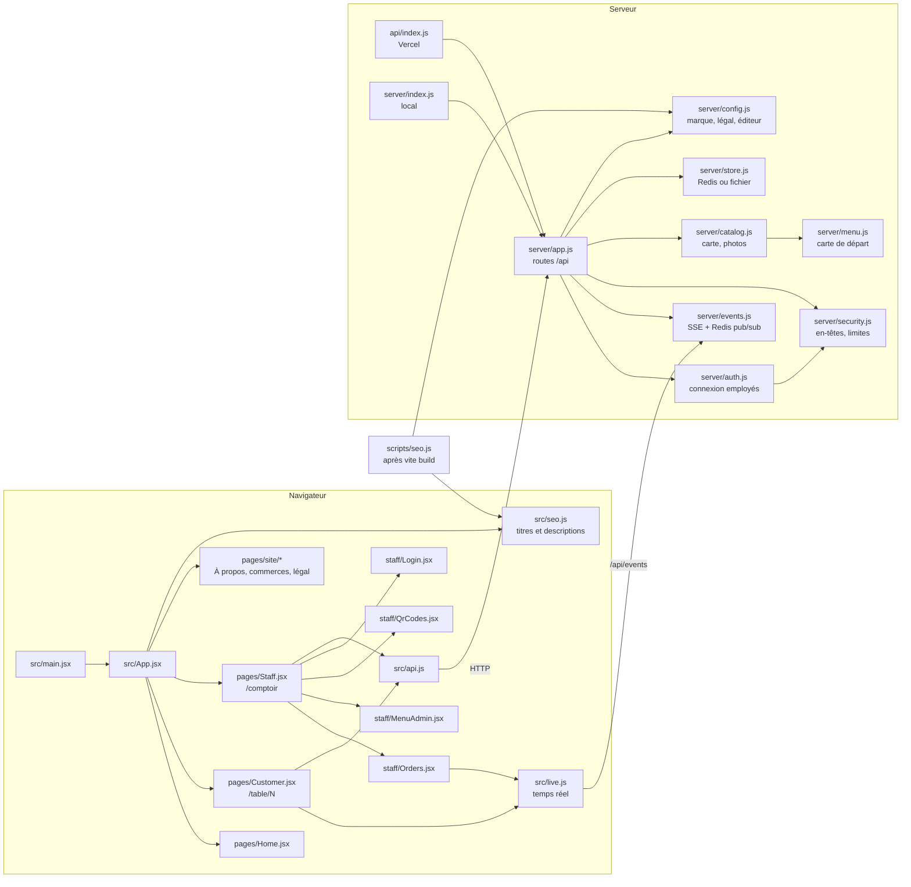

# Carte du code

Vue d'ensemble des fichiers et de leurs liens, pour s'y retrouver avant de modifier l'app.

| Besoin | Fichier |
| --- | --- |
| Changer le nom, les couleurs, les infos légales | `server/config.js` (ou variables `BRAND_*`, `LEGAL_*`, `VENDOR_*`) |
| Changer l'apparence (couleurs, polices, composants) | `DESIGN.md`, tokens dans `src/theme.css`, styles dans `src/styles.css`, composants partagés dans `src/components/ui.jsx` |
| Changer la carte | Espace employés, onglet Carte (logique : `server/catalog.js`, carte de départ : `server/menu.js`) |
| Ajouter une route d'API | `server/app.js` |
| Ajouter une page publique | `src/pages/site/`, `SITE_PAGES` dans `src/App.jsx`, `src/seo.js`, rewrites de `vercel.json` |
| En-têtes de sécurité, limites anti-abus | `server/security.js` (et `vercel.json` pour les pages statiques) |
