# Carte du code

Vue d'ensemble des fichiers et de leurs liens, pour s'y retrouver avant de modifier l'app.

```mermaid
graph LR
  subgraph Navigateur
    main[src/main.jsx] --> App[src/App.jsx]
    App --> Home[pages/Home.jsx]
    App --> Customer[pages/Customer.jsx<br/>/table/N]
    App --> Staff[pages/Staff.jsx<br/>/comptoir]
    App --> Site[pages/site/*<br/>À propos, commerces, légal]
    App --> seo[src/seo.js<br/>titres et descriptions]
    Staff --> Orders[staff/Orders.jsx]
    Staff --> MenuAdmin[staff/MenuAdmin.jsx]
    Staff --> QrCodes[staff/QrCodes.jsx]
    Staff --> Login[staff/Login.jsx]
    Customer --> live[src/live.js<br/>temps réel]
    Orders --> live
    Customer --> api[src/api.js]
    Staff --> api
  end

  subgraph Serveur
    vercel[api/index.js<br/>Vercel] --> app[server/app.js<br/>routes /api]
    local[server/index.js<br/>local] --> app
    app --> auth[server/auth.js<br/>connexion employés]
    app --> events[server/events.js<br/>SSE + Redis pub/sub]
    app --> security[server/security.js<br/>en-têtes, limites]
    auth --> security
    app --> catalog[server/catalog.js<br/>carte, photos]
    catalog --> menu[server/menu.js<br/>carte de départ]
    app --> routes[server/routes/*<br/>menu, admin, commandes, stats]
    routes --> orders[server/orders.js<br/>règles des commandes]
    orders --> shared[shared/*<br/>commun navigateur + serveur]
    app --> store[server/store.js<br/>Redis ou fichier]
    app --> config[server/config.js<br/>marque, légal, éditeur]
  end

  api -- HTTP --> app
  live -- /api/events --> events
  build[scripts/seo.js<br/>après vite build] --> config
  build --> seo
```

| Besoin | Fichier |
| --- | --- |
| Changer le nom, les couleurs, les infos légales | `server/config.js` (ou variables `BRAND_*`, `LEGAL_*`, `VENDOR_*`) |
| Changer l'apparence (couleurs, polices, composants) | `DESIGN.md`, tokens dans `src/theme.css`, styles dans `src/styles.css`, composants partagés dans `src/components/ui.jsx` |
| Changer la carte | Espace employés, onglet Carte (logique : `server/catalog.js`, carte de départ : `server/menu.js`) |
| Ajouter une route d'API | un routeur de `server/routes/`, branché dans `server/app.js` |
| Règles des commandes (prix, options, statuts) | `server/orders.js`, `shared/options.js`, `shared/orderStatus.js` (testés dans `test/`) |
| Traductions de l'interface client | `shared/i18n/` (fr, nl, en, pt) |
| Allergènes | `shared/allergens.js` |
| Cuisine, attente, écran de salle | `shared/kitchen.js`, `server/queue.js`, `src/pages/staff/Kitchen.jsx`, `src/pages/ReadyBoard.jsx` |
| Notifications « prête » | `server/push.js`, `server/orderEvents.js`, `public/sw.js`, `src/push.js` |
| À emporter, créneaux | `shared/pickup.js`, `server/takeaway.js` |
| Statistiques | `shared/stats.js`, `server/routes/stats.js`, `src/pages/staff/Stats.jsx` |
| Ajouter une page publique | `src/pages/site/`, `SITE_PAGES` dans `src/App.jsx`, `src/seo.js`, rewrites de `vercel.json` |
| En-têtes de sécurité, limites anti-abus | `server/security.js` (et `vercel.json` pour les pages statiques) |
